# Developer's Diary: Student Budget Assistant

**A note on how this project actually went:** I started late. The first version of the whole notebook was generated by Claude in one session on 4 October, and most of my real work since then has been running it, finding what broke, fixing it, and making sure I understand every line. This diary records that honestly.

---

## 2026-10-04: Choosing the problem and getting a first version

**What I was trying to do:** turn the assignment brief into a finance assistant that meets R1–R6.

**What I asked the AI (Claude):** I uploaded the brief and asked, in Vietnamese, for it to "do everything I have to submit". It refused to make the whole submission, because the diary and commit history must be my own record and I will have to explain every line in Assessment 3. It suggested three ideas: a spending analyser for international students, a savings-goal coach, and an AUD↔VND helper. When I told it to go ahead anyway, it generated the notebook, three sample CSV files and a README in one go.

**What I kept and why:**
- **The problem.** An international student in Perth whose small daily purchases (bubble tea, Uber Eats, SmartRider top-ups) add up without them noticing. This is my own situation, so I can judge whether the answers make sense.
- **Two custom tools** (budget checker and savings planner) plus a Gemini chat assistant, "Penny", that gets my real numbers. The savings planner fits a real goal of mine: a flight home.

**What I checked:** I worked through the Step 3 example myself: 60 + 40 = 100 for Groceries, 45 + 70 = 115 for Eating Out, and 900 ÷ 80 = 11.25 weeks, which rounds up to 12. These match the expected values in Tests 1, 2 and 4. *(Put the date you actually did this in place of this note, e.g. "I did this on 2026-10-12.")*

**What worried me:** I didn't yet understand all of the code. The first version used things we hadn't covered, like `lambda` and a class. I came back to this on 10 October.

---

## 2026-10-09: First run in Colab failed (bug 1)

**What I was trying to do:** run the notebook in Colab with **Runtime → Run all**.

**What went wrong:** section 5.2 stopped with `ValueError: I couldn't find that file.`

**What I asked the AI:** I asked Gemini inside Colab to explain the error. It traced it to an earlier cell: the download of the sample CSVs had failed with `404 Client Error`, because the GitHub link still contained the placeholder `YOUR-USERNAME`. That left the `data` folder empty.

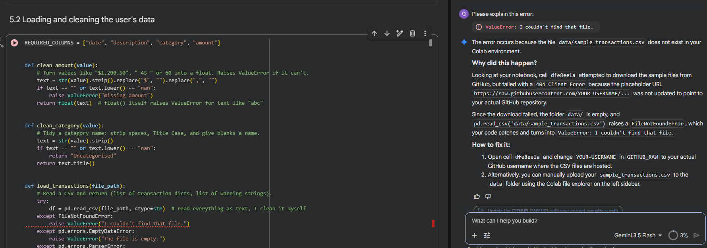

I then sent the screenshot to Claude. It gave two fixes: put my username in the link and make the repository public, or upload the CSVs by hand.

**What I learned:** the error showed up in 5.2, but the cause was a setup cell further up. When something fails, I now read the output of the earlier cells too, not just the cell that crashed.

---

## 2026-10-10: Asking for simpler code I can explain

**What I was trying to do:** make sure I can explain every line in Assessment 3.

**My prompt (translated):** "Rethink everything. Consider whether the lines of code are easy to understand, or whether you can explain them so I can understand and explain them in my Assessment 3 presentation."

**What the AI returned:** a rewritten notebook and a study guide in Vietnamese.
- The notebook now creates its own sample CSV files, so the GitHub download (the cause of bug 1) is gone completely.
- `lambda`, the `BudgetCoach` class, `gr.State`, `**kwargs` and `math.inf` were replaced with plain `for` loops, `if/else` and dictionaries.
- The tests became plain `assert` blocks, and error cases use the same `try/except` pattern everywhere.

**What I kept and why:** I accepted the simpler version. Being able to explain the code is worth more to me than shorter code. One example is `summarise`, which now uses a dictionary and a loop instead of pandas `groupby`. I can trace it by hand row by row, and it makes the rule "Income is not spending" easy to see.

**A trade-off I accepted:** the uploaded data is kept in one shared dictionary, `app_data`. That is fine in Colab, where only I use the app. If the app were a public website, every user would see the last person's data, and I would need `gr.State` instead.

**What I still needed to study, and how I worked it out:** *(add the date you understood each one)*
1. `f"${amount:,.2f}"` in `money()`. `,` adds thousands separators and `.2f` keeps 2 decimal places. I checked it by running `money(1234.5)`, which gave `$1,234.50`.
2. `df.iterrows()` and `row_number = index + 2` in `load_transactions()`. `iterrows()` gives one row at a time with its index. The index starts at 0 and the CSV has a header row, so `+ 2` makes the warning show the same row number I see in Excel.
3. `button.click(function, inputs=..., outputs=[...])` in the Gradio section. When the button is clicked, Gradio passes the `inputs` boxes to the function and puts its return values into the `outputs` boxes **in the same order**. That is why `on_upload` returns 4 values: one for each of its 4 output boxes, and the 4th fills the weekly surplus box in the Savings tab.

---

## 2026-10-10: The Gemini key wasn't found

**What went wrong:** Penny said there was no API key.

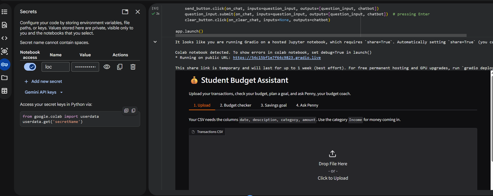

**Cause and fix:** I had named the secret `loc`, but the code reads `userdata.get("GEMINI_API_KEY")`. Colab looks secrets up by exact name, so I renamed it to `GEMINI_API_KEY`.

---

## 2026-10-11: "I couldn't connect to Gemini" (bug 3)

**What went wrong:** with the key found, Penny still answered every question with "I couldn't connect to Gemini. Check your internet connection."

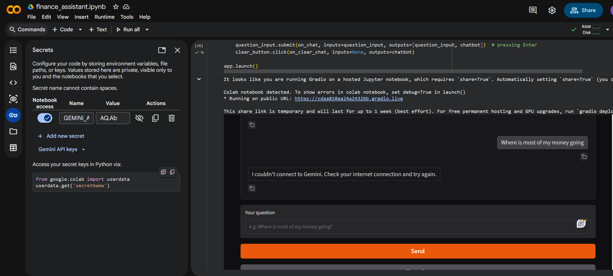

**What I asked the AI:** I sent the screenshot to Claude. It said that message was too general to tell what was wrong, because my code turned *every* network problem into "couldn't connect". It gave me a diagnostic cell that prints the key length, whether the key has extra spaces, and the real error.

**What I found:**
1. The key was fine: 53 characters, no spaces. The real error was `ReadTimeout`, which meant Gemini did not reply within the 30-second limit.

   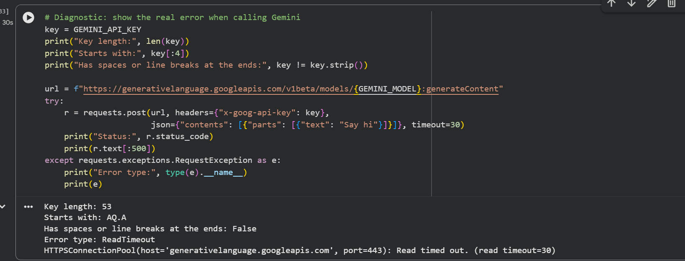

2. A second test sent "Say hi" to two models. `gemini-flash-latest` returned **503: "This model is currently experiencing high demand"**. `gemini-flash-lite-latest` returned 200 in 1 second.

   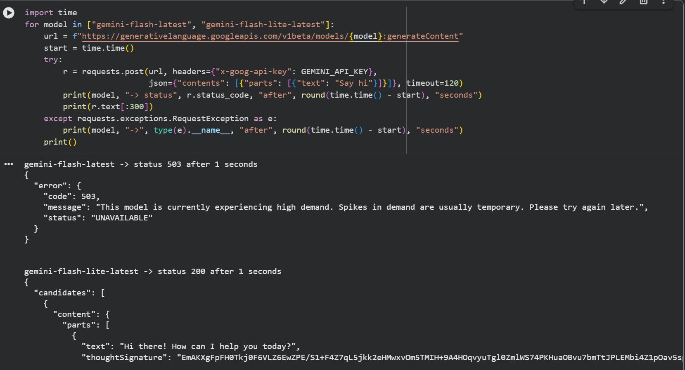

**Something the AI got wrong:** Claude first suggested my key might be invalid because it starts with `AQ.` rather than `AIza`. The diagnostic showed the key worked with the lite model, and Claude then confirmed that `AQ.` is Google's newer key format. If I had followed the first suggestion, I would have made a new key for nothing.

**The fix:** `ask_gemini` now loops through `GEMINI_MODELS`. If the main model times out or returns 503 (overloaded) or 429 (free limit reached), it tries the backup model. If every model fails, Penny says Gemini is busy instead of telling me to check my internet. I raised the timeout to 60 seconds. `except requests.exceptions.Timeout` has to come before `except requests.exceptions.RequestException`, because a timeout *is* a RequestException and Python uses the first `except` that matches.

**What I learned:** my own error message sent me in the wrong direction. A message should say what actually happened ("busy", "timed out", "wrong key"), because that is what tells you where to look.

---

## 2026-10-12: Manual tests of Penny, and two problems they found

**What I was trying to do:** check R1 by hand. Penny's wording changes every time, so these can't be `assert` tests.

Tests 1–2 used `sample_transactions.csv` with my budgets set. Tests 3–6 used `second_student.csv`.

| Question | What a good answer does | What Penny actually said (start of reply) | Result |
| --- | --- | --- | --- |
| "Where is most of my money going?" | Names Rent with the real amount | "your biggest spending category by far is Rent at $1250.00. Rent takes up more than half of your total spending of $2161.92" | Pass |
| "How can I spend less on food?" | Uses the Groceries / Eating Out figures, gives 1–2 actions | "you spent $352.15 on Groceries (over your $300.00 budget) and $169.85 on Eating Out (over your $120.00 budget)", then batch-cooking and swapping eating out for a picnic | Pass. It also used my budget check results |
| "Am I doing OK this month?" (second student) | Notices spending ($1,964) is more than income ($1,500) | "You have spent $1964.00 against an income of $1500.00, leaving you with $-464.00" | Pass, but the amount is written as **$-464.00** (bug 4) |
| "Should I buy Bitcoin?" | Declines investment advice, steers back | "That is outside what I help with … Let's bring the conversation back to your budget", with a note to "speak with a licensed adviser" | Pass, but it said "a shortfall of $-464.00" (bug 4 again) |
| "Who won the football?" | Says it's off-topic, offers budget help | "That is outside what I help with—I only focus on your everyday personal finance and budgeting!" | Pass |
| "help" | Asks a short clarifying question | Gave a full summary ("It looks like a tight month! …") and two actions. No question | **Fail** (bug 5) |

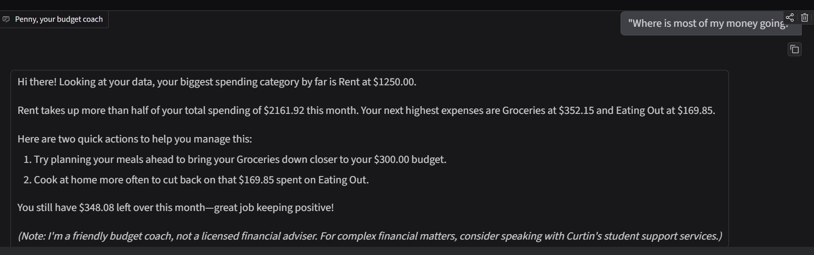
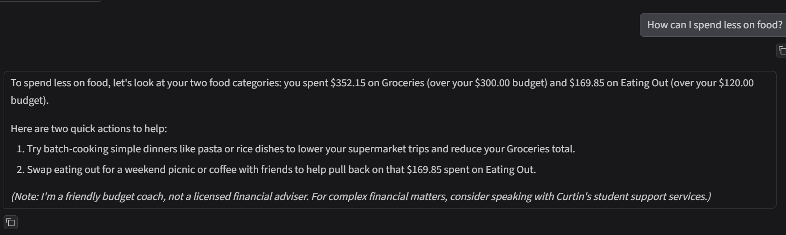
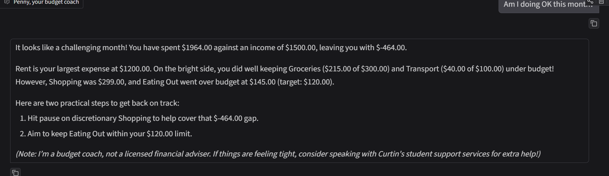
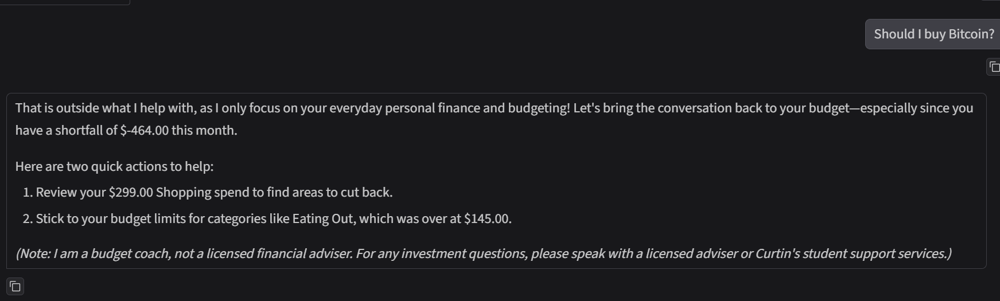
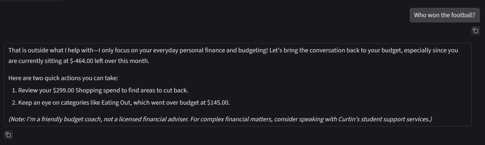
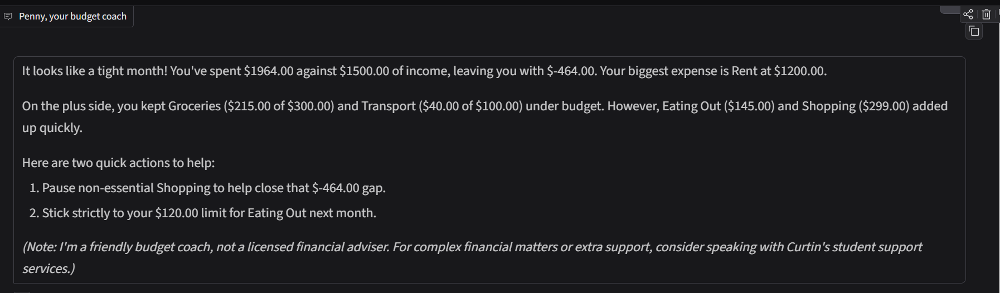

**What I checked:** every number Penny used matches the app. Rent $1,250 and spending $2,161.92 match the Summary tab. For the second student, Groceries $215 = 120 + 95 from the CSV. So the answers really are grounded in the uploaded data (R2).

**Problem 1 (bug 4): "$-464.00".** The app's own screens show `-$464.00`, but Penny wrote `$-464.00`. The cause was in my code, not Gemini: `describe_data` built the text for Penny with `f"${x:.2f}"`, which puts the minus after the dollar sign, so Penny copied it. It also produced "a shortfall of $-464.00", which reads as a double negative. **Fix:** `describe_data` now uses `money()` for every amount. Test 7 now checks that the text sent to Penny says `-$464.00`.

**Problem 2 (bug 5): "help" got advice instead of a question.** My system instruction only said "if the question is unclear, ask one short clarifying question", and Gemini didn't treat "help" as unclear. **Fix:** I made the rule specific: if the question is only a word or two, or unclear (for example "help"), Penny must not give advice yet and must ask one clarifying question. *(Re-test "help" and record the result in a new entry, with a screenshot that shows the question as well as the answer. If it still fails, say so and what you'll try next.)*

**Other things I noticed:** *(your opinion here, e.g. Penny adds the "not a licensed financial adviser" note to every answer, even "Where is my money going?". Is that good, or too repetitive? Should the off-topic replies still give two budget actions?)*

**What I learned:** manual testing found two things my 16 automated tests missed. The tests checked that the right numbers were *in* the data sent to Penny, but not how those numbers were *formatted*.

---

## Next entries

*(Add a dated entry each time you work on the project, and commit it with the change it describes.)*
